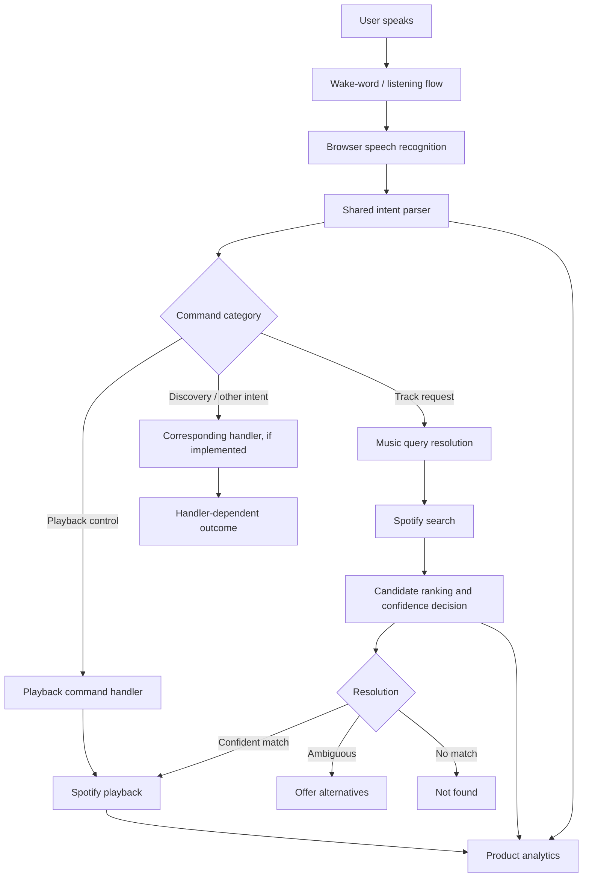

# Iris v7 — Voice-Controlled AI Music Assistant


### Your music. Your voice. Your Iris.

A browser-based, voice-first music assistant for discovering music and controlling Spotify through natural-language commands.

**Wake-word interaction · English and Hinglish · Intent recognition · Song matching · Spotify Web Playback SDK**

---

## Overview

**Iris** is a browser-based music assistant designed to make music discovery and playback feel more natural. Instead of navigating menus or typing every search, users can speak requests such as:

> "Iris, play Believer by Imagine Dragons."

Iris listens for its wake word, recognises the spoken command, interprets the user's intent and—where the relevant execution path is supported—uses Spotify search and playback to fulfil the request.

The product began with a simple idea: **make existing speakers smarter through software, without requiring dedicated smart-speaker hardware.**

Iris v7 combines browser speech recognition, a shared English/Hinglish intent parser, server-side music resolution and Spotify playback. Its parser can classify a broader range of music requests than the currently verified end-to-end execution paths. This README distinguishes those layers rather than implying that every recognised intent is already a complete feature.

## Product experience


*The Stage — Iris's immersive, voice-first interface.*

### Core capabilities

| Capability | What it does |
|---|---|
| Wake word | Activates listening when the user says "Iris". |
| Hands-free listening | Keeps voice interaction available and includes microphone recovery behaviour. |
| Tap-to-talk | Starts a listening window through the interface or the `L` shortcut. |
| English and Hinglish commands | Normalises common English and Hinglish phrasing. |
| Song discovery | Parses song and artist requests, including imperfect or phonetic input. |
| Candidate matching | Ranks Spotify search candidates and uses confidence decisions to avoid blindly choosing weak matches. |
| Alternative selection | Supports presenting and selecting alternatives when a request is ambiguous. |
| Spotify playback | Uses the Spotify Web Playback SDK to play music in the browser. |
| Playback controls | Supports pause, resume, next, previous, mute and volume controls in the existing playback flow. |
| Music ducking | Temporarily lowers playback volume while Iris listens and restores it when appropriate. |
| Diagnostics | Exposes application, voice, authentication and playback diagnostics. |
| Product analytics | Integrates PostHog event tracking for product behaviour. |

### Intent recognition: parser versus execution

The shared `shared/intent.js` module recognises structured command categories. Recognition by the parser does **not** by itself guarantee that the frontend, backend and Spotify controller execute every category.

The current parser taxonomy includes:

- Track playback and track search
- Album, playlist and artist requests
- Playback controls, including pause, resume, next and previous
- Volume increase, decrease, set and mute
- Discovery by mood, genre, activity, language and era
- Similar-music discovery
- Lyrics-based identification
- Refinement of a current discovery
- Clarification, rejection and option selection

Treat categories beyond the existing playback and song-resolution flows as **parser capabilities until their complete application path has been verified**. In particular, a parser result such as `PLAY_ALBUM`, `PLAY_PLAYLIST` or `DISCOVER_BY_MOOD` should not be interpreted as proof that Iris can already execute that request end to end.

## Example voice commands

The examples below illustrate the language the intent parser is designed to understand. Actual execution depends on the corresponding application handler being available.

### Song requests

```text
"Iris, play Believer"
"Play Stronger by Kanye West"
"Play Tum Hi Ho"
"Kesariya wala gaana bajao"
"Play Lonely by Akon"
```

### Playback and volume controls

| Command | Intended action |
|---|---|
| "Pause the music" | Pause playback |
| "Resume" | Resume playback |
| "Next song" | Skip to the next track |
| "Previous song" | Return to the previous track |
| "Volume up" | Increase volume |
| "Volume down" | Decrease volume |
| "Set volume to 40" | Set volume to 40% |
| "Mute" | Mute playback |
| "Option two" | Select the second suggested result |

### Discovery requests recognised by the intent parser

```text
"Play something romantic"
"Play some hip-hop"
"Play Hindi romantic songs"
"Play something for the gym"
"Play 2000s Bollywood songs"
"Play some chill R&B"
"Play something slower"
```

### Artist, album and playlist requests recognised by the parser

```text
"Play songs by Arijit Singh"
"Play an album by The Weeknd"
"Play the latest album by The Weeknd"
"Play a playlist for studying"
```

### Lyrics and Hinglish examples

```text
"Play that song that goes I got the power"
"Koi romantic gaana chalao"
"Thoda chill music lagao"
"Agla gaana play karo"
"Awaaz badhao"
```

### Conversational refinement examples

The parser includes intent categories for refining a current discovery. A multi-turn experience also requires the application to retain and pass the relevant conversation context.

```text
"Play something romantic"
"Something more upbeat"
"Play another one"
"Something in Hindi"
```

Do not assume these follow-ups preserve context in every application flow unless that behaviour has been verified in the running application.

## How Iris works



### Intent parser design

`shared/intent.js` is shared by browser and Node.js code. It normalises a spoken command and returns a structured result that can include:

- A backward-compatible command `type`
- A structured `intent` category
- A confidence value
- Extracted entities
- Extracted music preferences
- References to conversational context, where applicable
- Intent-specific fields such as a search query, volume value or option index

The parser includes English/Hinglish normalisation, command and control recognition, preference lexicons, and rules for distinguishing explicit playback commands from other phrases. Existing consumers may continue to use the legacy `type` field while newer code can inspect the structured `intent`.

### Song-resolution pipeline

For track requests, the music-resolution layer uses query parsing, Spotify search, candidate scoring and confidence decisions. The goal is to avoid playing the first result without considering whether it matches the requested title and artist.

An optional Anthropic-powered fallback may help generate candidate interpretations for difficult or fragmented requests. The normal search and matching pipeline does not require this optional fallback.

## Technology stack

| Layer | Technologies |
|---|---|
| Frontend | HTML, CSS, JavaScript |
| Speech recognition | Browser Web Speech API |
| Backend | Node.js, Express |
| Music catalogue | Spotify Web API |
| Audio playback | Spotify Web Playback SDK |
| Authentication | Spotify OAuth 2.0 |
| Intent recognition | Shared JavaScript parser (`shared/intent.js`) |
| Song resolution | Query parsing, candidate ranking and confidence scoring |
| Optional AI fallback | Anthropic API |
| Product analytics | PostHog |
| Deployment | Render |
| Testing | Node.js test suites; optional Playwright smoke tests |

## Project structure

```text
Iris-v7/
├── frontend/
│   ├── index.html
│   ├── style.css
│   ├── app.js
│   ├── voice.js
│   ├── spotify.js
│   ├── analytics.js
│   ├── flags.js
│   ├── duck.js
│   ├── polish.js
│   ├── polish.css
│   ├── stage.js
│   ├── stage.css
│   ├── iris.js
│   ├── manifest.json
│   └── icon.svg
├── backend/
│   ├── server.js
│   ├── auth.js
│   ├── routes/
│   │   └── resolve.js
│   └── music/
│       ├── llm.js
│       ├── query.js
│       ├── rank.js
│       ├── resolver.js
│       ├── spotifySearch.js
│       └── text.js
├── shared/
│   └── intent.js
├── test/
│   ├── matching.test.js
│   ├── contract.test.js
│   ├── voice.test.js
│   ├── duck.test.js
│   └── smoke/
├── docs/
│   └── MANUAL_CHECKS.md
├── .env.example
├── .gitignore
├── package.json
├── CHANGELOG.md
├── DESIGN.md
├── TASKS.md
├── CLAUDE.md
└── README.md
```

### Important modules

| Module | Responsibility |
|---|---|
| `frontend/app.js` | Connects voice commands, application state and playback actions. |
| `frontend/voice.js` | Wake-word detection, speech recognition, tap-to-talk and microphone recovery. |
| `frontend/spotify.js` | Initialises the Spotify player and controls playback. |
| `frontend/analytics.js` | Initialises PostHog and captures configured product events. |
| `frontend/stage.js` | Drives the primary Iris interface and interaction states. |
| `frontend/duck.js` | Handles volume reduction and restoration while listening. |
| `frontend/flags.js` | Controls optional frontend features. |
| `frontend/iris.js` | Renders the animated Iris eye. |
| `backend/server.js` | Express server, static frontend hosting and API routes. |
| `backend/auth.js` | Spotify OAuth, token handling and authentication diagnostics. |
| `backend/music/query.js` | Parses and normalises music search queries. |
| `backend/music/rank.js` | Scores and ranks candidate tracks. |
| `backend/music/resolver.js` | Coordinates search, ranking and confidence decisions. |
| `backend/music/llm.js` | Optional AI-assisted candidate generation. |
| `shared/intent.js` | Shared English/Hinglish command interpretation and structured intent output. |

## Getting started

### Requirements

- Node.js (use a currently supported LTS release).
- npm.
- A Spotify account with Premium for Spotify Web Playback SDK streaming.
- A Spotify Developer application.
- Google Chrome or Microsoft Edge.
- A working microphone and network connection.

### 1. Clone the repository

```bash
git clone https://github.com/snorelax08/Iris-v7.git
cd Iris-v7
```

### 2. Install dependencies

```bash
npm install
```

### 3. Create a Spotify Developer application

1. Open the [Spotify Developer Dashboard](https://developer.spotify.com/dashboard).
2. Create an application.
3. Copy its Client ID and Client Secret.
4. Add the local redirect URI used by your environment configuration.

For the default local setup documented in the project:

```text
http://127.0.0.1:8888/auth/callback
```

The redirect URI in the Spotify Developer Dashboard must exactly match `SPOTIFY_REDIRECT_URI`.

### 4. Configure environment variables

Create a local `.env` file from `.env.example`.

macOS/Linux:

```bash
cp .env.example .env
```

Windows PowerShell:

```powershell
Copy-Item .env.example .env
```

Set the Spotify credentials and other required values according to `.env.example`. The local callback and port commonly use:

```env
SPOTIFY_CLIENT_ID=your_spotify_client_id
SPOTIFY_CLIENT_SECRET=your_spotify_client_secret
SPOTIFY_REDIRECT_URI=http://127.0.0.1:8888/auth/callback
PORT=8888
```

The current authentication implementation may also require a valid `TOKEN_ENCRYPTION_KEY`. Check `.env.example` and `backend/auth.js` for the exact format and required settings. Do not reuse or replace a production encryption key for local testing.

Optional AI-assisted song resolution:

```env
ANTHROPIC_API_KEY=your_anthropic_api_key
AKON_LLM_MODEL=claude-haiku-4-5
AKON_LLM_TIMEOUT_MS=2500
```

Optional Spotify search configuration:

```env
AKON_SEARCH_LIMIT=10
```

The Anthropic configuration is optional; the normal search and matching pipeline is designed to work without it.

**Never commit `.env` files, Spotify secrets, encryption keys or private API credentials.**

### 5. Start Iris

```bash
npm start
```

The documented default local port is `8888`. Open:

```text
http://127.0.0.1:8888
```

If your `.env` or server configuration uses a different port, use the URL printed or configured by your local application.

### 6. Connect Spotify and start listening

1. Select **Connect Spotify**.
2. Sign in and approve the requested permissions.
3. Wait for the Spotify Web Playback SDK player to initialise.
4. Allow microphone access in the browser.
5. Say "Iris, play Believer" or use tap-to-talk.

## Product analytics — PostHog

Iris integrates with [PostHog](https://posthog.com/) to understand product usage and identify friction in the voice and playback experience.

The existing README describes a client-side PostHog SDK configuration with automatic page-view tracking, autocapture, page-leave capture and session recording disabled. Verify the current `frontend/analytics.js` configuration before changing analytics behaviour.

Events documented by the project include:

- `app_opened`
- `spotify_auth_succeeded`
- `spotify_auth_failed`
- `player_ready`
- `voice_session_started`
- `voice_session_ended`
- `voice_command_received`
- `intent_parsed`
- `song_search_completed`
- `song_option_selected`
- `playback_attempted`
- `playback_started`
- `playback_failed`
- `command_action_completed`

The PostHog project key used in browser code is a client-side ingestion key, not a private administrative API key. Never expose private PostHog credentials in frontend code.

Review the current analytics implementation and user-consent experience before using analytics with external users.

## Testing

The project includes automated test suites for matching, application contracts, voice behaviour and music ducking.

Run the complete suite:

```bash
npm test
```

The test script currently runs:

1. `node test/matching.test.js` — song matching and resolution behaviour.
2. `node test/contract.test.js` — frontend DOM, scripts, APIs and route contracts.
3. `node test/voice.test.js` — wake-word detection and microphone lifecycle behaviour.
4. `node test/duck.test.js` — volume ducking and restoration behaviour.

Run an individual suite with:

```bash
node test/matching.test.js
node test/contract.test.js
node test/voice.test.js
node test/duck.test.js
```

These automated tests do not, by themselves, prove that every parser intent is integrated with a live Spotify execution path. Perform manual testing with a connected Spotify account as well.

### Manual testing

- Connect Spotify and verify the player reaches its ready state.
- Allow microphone access.
- Test wake-word detection and tap-to-talk.
- Play a known English-language track.
- Play a Hindi or Hinglish track.
- Test imperfect song titles and artist names.
- Test ambiguous search results and alternative selection.
- Test pause, resume, next and previous.
- Test volume controls and mute.
- Test microphone recovery after interruptions.
- Verify analytics events in PostHog, subject to the project's consent configuration.
- Test discovery and conversational requests individually; record parser recognition separately from successful playback.

### Optional browser smoke tests

```bash
npm run smoke
```

The smoke test uses Playwright when available. Check `package.json` and the smoke-test documentation for its setup requirements.

## Deployment — Render

Iris uses an Express backend that also serves the frontend. The project has been deployed as a Render Web Service.

Typical Render settings:

| Setting | Value |
|---|---|
| Runtime | Node |
| Build command | `npm install` |
| Start command | `npm start` |
| Branch | `main` |

Configure the Spotify credentials and all other required environment variables in the Render service's environment settings. Do not commit production secrets.

The production Spotify callback must match the URL configured in both Render and the Spotify Developer Dashboard:

```text
https://YOUR-SERVICE.onrender.com/auth/callback
```

After deployment, verify application loading, Spotify OAuth, player initialisation, microphone permissions, song resolution, playback controls and analytics delivery. A successful GitHub merge does not by itself prove that a deployment completed successfully.

## Security and production considerations

Iris handles Spotify credentials and user-authorised playback. Authentication and token handling must be reviewed against the current implementation before the service is exposed to additional users.

Important areas to verify include:

- OAuth state generation and validation.
- Session isolation between browsers and users.
- Secure session-cookie settings.
- Token encryption and encryption-key management.
- Access-token expiry and refresh behaviour.
- Persistent session storage and database configuration.
- Logout and token revocation behaviour.
- Rate limiting and safe error handling.
- Avoiding secrets and sensitive tokens in logs.
- Analytics consent and data-retention practices.

Do not assume that a local test or passing unit tests establish production security or multi-user readiness. Keep production credentials in the hosting provider's secret environment configuration, never in source control.

## Current limitations

- Spotify Web Playback SDK streaming requires Spotify Premium.
- Playback takes place through the browser's Spotify Web Playback SDK device.
- Browser speech recognition support varies by browser and operating system.
- Microphone permission is required for voice interaction.
- The browser/device must remain active for continuous voice interaction.
- Parser recognition does not guarantee that every discovery, album, playlist, artist or conversational intent has a complete execution handler.
- Live Spotify behaviour and authentication should be tested separately from automated unit tests.

## Roadmap

Potential areas for future development include:

- More robust multi-user authentication and session management.
- Better multilingual and Indian-accent speech handling.
- More reliable wake-word activation across devices.
- Improved song identification from lyrics and partial phrases.
- End-to-end mood, genre, activity, language and era discovery.
- Context-aware conversational follow-ups and user preferences.
- Expanded album, artist and playlist playback flows.
- Stronger product analytics, retention measurement and user consent controls.
- Exploring a companion agent skill for AI coding agents and agent marketplaces.

An agent-skill distribution is an exploratory possibility, not a current Iris integration. The primary product remains the browser-based voice music assistant.

## Contributing

Iris is an evolving project. Contributions should be focused, tested and consistent with the existing architecture.

```bash
git clone https://github.com/snorelax08/Iris-v7.git
cd Iris-v7
npm install
npm test
```

Please preserve existing test coverage, document behavioural changes and never commit credentials or local environment files.

## Acknowledgements

- [Spotify Developer Platform](https://developer.spotify.com/documentation/web-api)
- [Spotify Web Playback SDK](https://developer.spotify.com/documentation/web-playback-sdk)
- [PostHog](https://posthog.com/)
- [Anthropic](https://www.anthropic.com/) — optional AI-assisted song resolution
- [Node.js](https://nodejs.org/)
- [Express](https://expressjs.com/)

---

**Iris — Your music, one conversation away.**

Built with curiosity, music and a lot of iteration.
