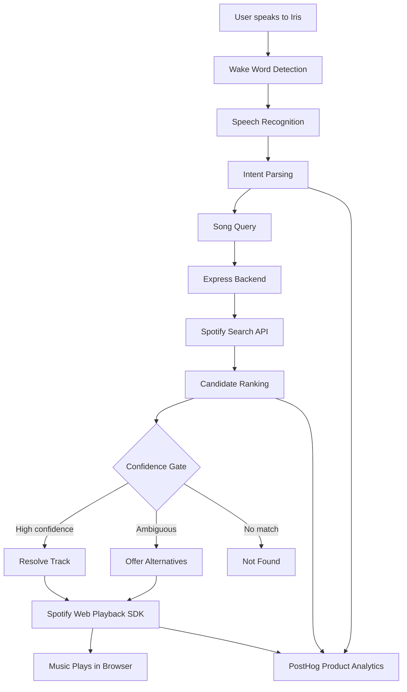

# Iris — Voice-Controlled AI Music Assistant

<p align="center">
  
</p>

<h3 align="center">
  Your music. Your voice. Your Iris.
</h3>

<p align="center">
  A voice-first music assistant that lets you discover, search and control Spotify playback through natural conversation.
</p>

<p align="center">
  <b>Wake-word interaction · Hinglish song discovery · Intelligent matching · Spotify Web Playback SDK · Product Analytics</b>
</p>

---

## Overview

**Iris** is a browser-based, voice-controlled music assistant designed to make music interaction more natural and effortless.

Instead of navigating playlists, searching manually or reaching for your phone to control playback, users can simply say what they want to hear.

Say **"Iris, play Believer"**, and Iris interprets the request, searches Spotify, identifies the most relevant track and starts playback directly in the browser.

Iris is built around a simple product idea:

> Make existing speakers smarter through software, without requiring users to purchase dedicated smart-speaker hardware.

The current prototype focuses on voice-controlled music discovery and playback. Its longer-term product vision is to evolve into a broader voice-first assistant.

## Product Experience

<p align="center">
  
</p>

*The Stage — Iris's immersive, voice-first interface.*

### Core Features

| Feature | Description |
|---|---|
| Voice Wake Word | Activate Iris by saying "Iris". |
| Hands-Free Listening | Listen continuously for voice commands with microphone resilience and automatic recovery. |
| Tap-to-Talk | Activate listening by tapping the eye, using the listening button or pressing `L`. |
| Natural Language Commands | Understand common English and Hinglish music commands. |
| Intelligent Song Discovery | Resolve imperfect, phonetic and transliterated song requests. |
| Confidence-Based Matching | Rank Spotify search results and avoid playing uncertain matches automatically. |
| Alternative Suggestions | Present candidate tracks when Iris cannot confidently determine the intended song. |
| Spotify Playback | Play music directly through the Spotify Web Playback SDK. |
| Playback Controls | Pause, resume, skip, go back, mute and adjust volume through voice or the interface. |
| Music Ducking | Automatically lower music volume while Iris listens, then restore it appropriately. |
| Adaptive Interface | Visual states for idle, listening, thinking, searching, playing and errors. |
| Diagnostics | Inspect voice activity, authentication status, playback state and search results. |
| Product Analytics | Track activation, voice interactions, song discovery and playback outcomes through PostHog. |

---

## How Iris Works

Iris combines browser-based speech recognition, server-side song resolution and Spotify's playback infrastructure.



### Technology Stack

| Layer | Technologies |
|---|---|
| Frontend | HTML, CSS, JavaScript |
| Speech Recognition | Web Speech API |
| Backend | Node.js, Express.js |
| Music Platform | Spotify Web API |
| Audio Playback | Spotify Web Playback SDK |
| Authentication | Spotify OAuth 2.0 |
| Song Resolution | Custom query parsing, ranking and confidence scoring |
| Optional AI Fallback | Anthropic API |
| Product Analytics | PostHog |
| Deployment | Render |
| Version Control | Git and GitHub |
| Testing | Node.js test suites, optional Playwright smoke tests |

---

## Voice Interaction

Iris supports a range of music commands in English and common Hinglish phrasing.

### Music Discovery

```text
"Iris, play Believer"
"Iris, play Stronger by Kanye West"
"Iris, Kesariya bajao"
"Iris, ye tune kya kiya"
```

### Playback Controls

| Voice Command | Expected Action |
|---|---|
| "Iris, pause" | Pause playback |
| "Iris, resume" | Resume playback |
| "Iris, next" | Play the next track |
| "Iris, previous" | Return to the previous track |
| "Iris, volume up" | Increase volume |
| "Iris, volume down" | Decrease volume |
| "Iris, volume 40" | Set volume to 40% |
| "Iris, mute" | Mute playback |
| "Iris, option two" | Select the second suggested track |

### Handling Ambiguous Requests

Iris does not simply play the first Spotify search result.

Its resolution pipeline uses:

- Hinglish-aware text normalization.
- Phonetic matching for imperfect speech recognition.
- Structured song-title and artist extraction.
- Candidate ranking and deduplication.
- Filtering for irrelevant results, including karaoke and tribute versions when inappropriate.
- Confidence thresholds to decide whether to play, offer alternatives or return no match.
- An optional LLM fallback for difficult or fragmented queries.

The LLM fallback can suggest candidate titles and artists, but those candidates still pass through the matching and confidence pipeline.

---

## Project Architecture

```text
Iris-v7/
│
├── frontend/
│   ├── index.html
│   ├── style.css
│   ├── app.js
│   ├── voice.js
│   ├── spotify.js
│   ├── analytics.js
│   ├── flags.js
│   ├── duck.js
│   ├── polish.js
│   ├── polish.css
│   ├── stage.js
│   ├── stage.css
│   ├── iris.js
│   ├── manifest.json
│   └── icon.svg
│
├── backend/
│   ├── server.js
│   ├── auth.js
│   │
│   ├── routes/
│   │   └── resolve.js
│   │
│   └── music/
│       ├── llm.js
│       ├── query.js
│       ├── rank.js
│       ├── resolver.js
│       ├── spotifySearch.js
│       └── text.js
│
├── shared/
│   └── intent.js
│
├── test/
│   ├── matching.test.js
│   ├── contract.test.js
│   ├── voice.test.js
│   ├── duck.test.js
│   └── smoke/
│
├── docs/
│   └── MANUAL_CHECKS.md
│
├── .env.example
├── .gitignore
├── package.json
├── CHANGELOG.md
├── DESIGN.md
├── TASKS.md
├── CLAUDE.md
└── README.md
```

### Important Modules

| Module | Responsibility |
|---|---|
| `frontend/app.js` | Connects voice commands, Spotify playback and application state. |
| `frontend/voice.js` | Wake-word detection, speech recognition, tap-to-talk and microphone recovery. |
| `frontend/spotify.js` | Initializes the Spotify player and controls playback. |
| `frontend/analytics.js` | Initializes PostHog and captures approved product events. |
| `frontend/stage.js` | Drives the primary Iris interface and interaction states. |
| `frontend/duck.js` | Handles volume reduction and restoration while listening. |
| `frontend/flags.js` | Controls optional frontend features. |
| `frontend/iris.js` | Renders the animated Iris eye. |
| `backend/server.js` | Express server, static frontend hosting and API routes. |
| `backend/auth.js` | Spotify OAuth, token refresh and authentication diagnostics. |
| `backend/music/query.js` | Parses and normalizes music search queries. |
| `backend/music/rank.js` | Scores and ranks candidate tracks. |
| `backend/music/resolver.js` | Coordinates search, ranking and confidence decisions. |
| `backend/music/llm.js` | Optional AI-assisted candidate generation. |
| `shared/intent.js` | Shared English and Hinglish command interpretation. |

---

## Getting Started

### Requirements

- Node.js 16 or later.
- npm.
- A Spotify account with Premium for Web Playback SDK music streaming.
- A Spotify Developer application.
- Google Chrome or Microsoft Edge.
- A working microphone.
- A network connection.

### 1. Clone the Repository

```bash
git clone https://github.com/snorelax08/Iris-v7.git
cd Iris-v7
```

### 2. Install Dependencies

```bash
npm install
```

### 3. Create a Spotify Developer Application

1. Open the [Spotify Developer Dashboard](https://developer.spotify.com/dashboard).
2. Create a new application.
3. Open its settings.
4. Copy the Spotify Client ID and Client Secret.
5. Register the following local redirect URI:

```text
http://127.0.0.1:8888/auth/callback
```

The redirect URI must match the value configured in your environment variables exactly.

### 4. Configure Environment Variables

Create a local `.env` file from `.env.example`.

On macOS/Linux:

```bash
cp .env.example .env
```

On Windows PowerShell:

```powershell
Copy-Item .env.example .env
```

Configure the following:

```env
SPOTIFY_CLIENT_ID=your_spotify_client_id
SPOTIFY_CLIENT_SECRET=your_spotify_client_secret

SPOTIFY_REDIRECT_URI=http://127.0.0.1:8888/auth/callback

PORT=8888
```

Optional AI-assisted song resolution:

```env
ANTHROPIC_API_KEY=your_anthropic_api_key
AKON_LLM_MODEL=claude-haiku-4-5
AKON_LLM_TIMEOUT_MS=2500
```

Optional Spotify search configuration:

```env
AKON_SEARCH_LIMIT=10
```

The Anthropic configuration is optional. Iris can use its normal search and matching pipeline without it.

**Never commit your actual `.env` file or private API credentials to GitHub.**

### 5. Run Iris

```bash
npm start
```

The Express server starts on port `8888` by default.

Open:

```text
http://127.0.0.1:8888
```

### 6. Connect Spotify

1. Select **Connect Spotify**.
2. Sign in to Spotify.
3. Approve the requested permissions.
4. Wait for the Spotify Web Playback SDK to initialize.
5. Allow microphone access when prompted.

### 7. Start Using Iris

Say:

```text
Iris, play Believer
```

Or tap the central Iris eye to use tap-to-talk.

---

## Product Analytics — PostHog

Iris integrates with [PostHog](https://posthog.com/) to understand how users interact with the product.

The objective is to measure product behaviour and identify areas where users encounter friction.

### Analytics Architecture

The application uses a client-side PostHog SDK with a controlled event allowlist.

Automatic page-view tracking, autocapture, page-leave capture and session recording are disabled in the current configuration.

### Tracked Events

| Event | Purpose |
|---|---|
| `app_opened` | Tracks application launches. |
| `spotify_auth_succeeded` | Tracks successful Spotify authentication. |
| `spotify_auth_failed` | Tracks authentication failures. |
| `player_ready` | Tracks successful player initialization. |
| `voice_session_started` | Tracks the beginning of a listening session. |
| `voice_session_ended` | Tracks when a listening session ends. |
| `voice_command_received` | Tracks received voice commands. |
| `intent_parsed` | Tracks intent interpretation. |
| `song_search_completed` | Tracks song-resolution results. |
| `song_option_selected` | Tracks alternative selection. |
| `playback_attempted` | Tracks playback requests. |
| `playback_started` | Tracks confirmed playback starts. |
| `playback_failed` | Tracks playback failures. |
| `command_action_completed` | Tracks completion of playback-control actions. |

### Key Product Metrics

The PostHog dashboard is designed to measure:

- Daily active users.
- Voice commands per day.
- Song-search outcomes.
- Search success rate.
- Playback attempt-to-start conversion.
- Voice interaction patterns.
- User retention and repeat engagement.

### Analytics Configuration

The PostHog project key is used by the frontend SDK as a client-side ingestion key.

The current configuration uses:

```text
https://us.i.posthog.com
```

The project key is configured in:

```text
frontend/analytics.js
```

This is a public client-side project token, not a private PostHog personal API key. Never put private API keys or administrative credentials in frontend code.

**Consent:** Analytics capture is configured to be opt-out by default. The current prototype exposes `IrisAnalytics.optIn()` and `IrisAnalytics.optOut()`, but a visible user-facing consent interface still needs to be implemented before broader external testing.

---

## Testing

Iris includes automated tests for search matching, intent parsing, frontend contracts, microphone behaviour and music ducking.

Run the complete test suite:

```bash
npm test
```

The test command runs:

1. `matching.test.js` — music search and ranking behaviour.
2. `contract.test.js` — frontend DOM, APIs, routes and script contracts.
3. `voice.test.js` — wake-word detection and microphone resilience.
4. `duck.test.js` — volume ducking and restoration behaviour.

These tests run without live Spotify credentials.

### Optional Browser Smoke Tests

```bash
npm run smoke
```

The smoke test uses Playwright when available. Playwright is not installed automatically as a project dependency.

### Manual Testing

After running Iris locally:

- Connect Spotify.
- Verify that the player reaches the ready state.
- Allow microphone access.
- Test wake-word detection.
- Test tap-to-talk.
- Play a known English song.
- Play a Hindi or Hinglish song.
- Test ambiguous search results.
- Test pause, resume, next and previous.
- Test volume controls and mute.
- Check microphone recovery after interruptions.
- Verify PostHog events in the project Activity view.

---

## Deployment — Render

Iris uses an Express backend that also serves the frontend. Deploy it as a **Render Web Service**.

### 1. Create a Render Web Service

1. Open [Render](https://render.com/).
2. Create a new Web Service.
3. Connect your GitHub account.
4. Select `snorelax08/Iris-v7`.
5. Select the `main` branch.

### 2. Configure Build Settings

| Setting | Value |
|---|---|
| Runtime | Node |
| Build Command | `npm install` |
| Start Command | `npm start` |
| Branch | `main` |

### 3. Configure Render Environment Variables

In Render → Environment, configure:

```env
SPOTIFY_CLIENT_ID=your_spotify_client_id
SPOTIFY_CLIENT_SECRET=your_spotify_client_secret

SPOTIFY_REDIRECT_URI=https://your-service-name.onrender.com/auth/callback
```

Do not manually set `PORT` unless required by your hosting configuration. Render provides it automatically.

Add the optional Anthropic variables only if the AI fallback is enabled.

### 4. Update Spotify Redirect URI

In the Spotify Developer Dashboard, register the exact production callback:

```text
https://your-service-name.onrender.com/auth/callback
```

The production redirect URI in Render and Spotify must match exactly.

### 5. Deploy

Deploy the service and open the generated Render URL.

Test:

- Application loading.
- Spotify OAuth.
- Player initialization.
- Microphone permission.
- Wake-word recognition.
- Song discovery.
- Playback controls.
- PostHog event delivery.

The existing PostHog dashboard does not need to be recreated. Production events will appear in the same project when the deployed application uses the existing PostHog configuration and users have opted in.

---

## Security & Production Readiness

Iris is currently a prototype, not a fully hardened multi-user production service.

The current Spotify authentication implementation has important limitations:

- OAuth access and refresh tokens are stored in one shared in-memory token store.
- Tokens are not isolated per user or browser session.
- Authentication state is generated but not validated in the OAuth callback.
- Server restarts clear the in-memory token store.
- The current implementation is intended for local development and controlled testing.

**Do not treat the current authentication implementation as suitable for unrestricted multi-user deployment.**

Before opening Iris to independent users, implement:

1. Session-based, per-user Spotify authentication.
2. Secure server-side session storage.
3. OAuth state validation and CSRF protection.
4. Secure, HTTP-only session cookies.
5. Persistent and appropriately protected token storage.
6. Authentication and API rate limiting.
7. A user-facing analytics consent interface.
8. Appropriate production privacy and data-retention settings.

### Credential Handling

- Keep Spotify Client Secrets on the server.
- Store production credentials in Render environment variables.
- Never commit `.env` files or private API keys.
- Keep browser-side PostHog project tokens separate from private administrative credentials.
- Do not expose private credentials in logs, screenshots or debugging endpoints.

---

## Current Limitations

- Spotify Web Playback SDK requires Spotify Premium.
- Music playback takes place in the browser's Spotify Web Playback SDK device.
- Iris does not directly control a user's Spotify desktop or mobile application.
- Speech recognition support varies by browser.
- Microphone permissions are required.
- The browser or device must remain active for voice interaction.
- The current OAuth backend is single-user and in-memory.
- Analytics requires explicit opt-in in the current implementation.

---

## Roadmap

Iris is being developed iteratively, with an emphasis on improving the product through real user feedback and measurable outcomes.

Potential areas of development include:

- Multi-user authentication and session management.
- Improved song recognition and multilingual speech support.
- More reliable voice activation across devices.
- Better handling of song requests from lyrics and partial phrases.
- User preferences and personalized music discovery.
- Product analytics and retention measurement.
- A dedicated user-facing consent and privacy experience.
- Expansion into additional voice-assistant capabilities.

---

## Contributing

Iris is an evolving project.

For development:

```bash
git clone https://github.com/snorelax08/Iris-v7.git
cd Iris-v7
npm install
npm test
```

Keep changes focused, preserve existing test coverage and avoid committing credentials or local environment files.

---

## Acknowledgements

- [Spotify Developer Platform](https://developer.spotify.com/documentation/web-api)
- [Spotify Web Playback SDK](https://developer.spotify.com/documentation/web-playback-sdk)
- [PostHog](https://posthog.com/)
- [Anthropic](https://www.anthropic.com/) — optional AI-assisted song resolution
- [Node.js](https://nodejs.org/)
- [Express](https://expressjs.com/)

---

<p align="center">
  <b>Iris — Your music, one conversation away.</b>
  <br />
  Built with curiosity, music and a lot of iteration.
</p>
